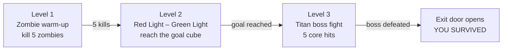

# Titan's Arena

A single-arena 3D game in Python and OpenGL where three levels (zombie combat, Red Light–Green Light, and a Titan boss fight) reuse the same arena and only the rules change.

  
  
  

## Game Setup

| Component | Details |
|-----------|---------|
| Language | Python 3 |
| Graphics | PyOpenGL (OpenGL + GLU + GLUT) |
| Window | 1000 × 800, double-buffered, depth test enabled |
| Arena | One 4000 × 4000 checkerboard floor with four walls, four pillars, and a goal door |
| Player | Blue Titan-bot holding a gun in both hands, 3 lives |
| Models | Built only from OpenGL primitives (cubes, spheres, cylinders, quads, lines) |
| File | `titan_arena.py` (single file) |

## Levels

| Level | Rule | How to advance |
|-------|------|----------------|
| 1. Zombie warm-up | Zombies chase the player. One bullet kills one zombie. A zombie touching the player costs a life. | Kill 5 zombies |
| 2. Red Light – Green Light | Zombies are gone and a giant grey Titan stands frozen at the centre. The light flips every 3 seconds, and the floor and door turn red on Red Light. Pressing a movement key on Red Light costs a life and sends the player back to the start. | Reach the cyan cube near the goal wall |
| 3. Titan boss fight | The Titan fires a laser at the player. Pillars can block it. The Titan's core can only be damaged in the cooldown phase. | Land 5 core hits |

### Boss Cycle (Level 3)

The boss repeats a 10-second finite state machine:

| Phase | Time | Behaviour |
|-------|------|-----------|
| IDLE | 0–2 s | Titan stands still. |
| ATTACK | 2–7 s | Titan turns red and fires a laser. If no pillar is on the line of sight, the player slowly loses life. |
| COOLDOWN | 7–10 s | Titan stops attacking. Bullets damage it only in this window. |

Each pillar absorbs laser hits, changes colour as it weakens, and disappears after 3 hits.

## Controls

| Key | Action |
|-----|--------|
| `W` `A` `S` `D` | Move forward / left / back / right |
| `Q` `E` or `←` `→` | Rotate |
| `Space` or Left Click | Shoot |
| `V` | Switch first-person / third-person camera |
| `↑` `↓` | Raise / lower the camera |
| `C` | Cheat mode (auto-fire, no damage) |
| `F` | Exit the arena after beating the boss |
| `R` | Restart |

## Code Overview

| Function | Role |
|----------|------|
| `reset_game()` | Resets lives, level, timers, zombies, pillars, and bullets |
| `drawArena()`, `drawPillars()`, `drawWeaponPickup()` | Environment and goal object |
| `drawTitan()`, `draw_limb()`, `drawZombie()` | Characters, including the player's arms and gun |
| `update()` | Game loop: level logic, light timer, boss state machine, laser and pillar checks, bullets, win/lose |
| `display()` | Camera, scene rendering, and HUD (level, lives, score, boss health) |
| `keyboard()`, `specialKeys()`, `mouse()` | Input handling |

## Key Concepts

- **Finite state machines** for levels, the Red/Green light, and the boss phases
- **Line-of-sight laser check**: a pillar blocks the laser if it lies within 100 units of the Titan–player line
- **Timer-driven mechanics** using `glutTimerFunc` (about 60 FPS) and `time.time()`
- **Projectile collision** by 2D distance (zombie radius 50, boss radius 300)
- **Hierarchical modelling** with nested `glPushMatrix` / `glPopMatrix`
- **Chase and first-person cameras** with `gluLookAt`
